# CMS

¿Qué es un CMS (Content Management System)?

Un CMS o Sistema de Gestión de Contenidos es una aplicación que permite crear, organizar, publicar y mantener una página web sin tener que programar toda la web desde cero.

Su objetivo principal es facilitar la gestión de una página web, separando la creación y administración de contenidos del desarrollo técnico de la aplicación.

El **administrador (Administrator)** es el perfil con mayor nivel de permisos. Su responsabilidad es garantizar que la plataforma funcione correctamente, sea segura y esté disponible.

Sus principales tareas son:
- Gestión de usuarios: crear cuentas, asignar roles y controlar permisos.
- Seguridad: gestionar contraseñas, actualizaciones y medidas de protección.
- Mantenimiento: actualizar WordPress, temas y plugins.
- Configuración: gestionar ajustes generales, apariencia y funcionalidades.
- Copias de seguridad: garantizar que se puedan recuperar los datos.
- Supervisión: comprobar que la web funciona correctamente.

**Un CMS facilita la creación y gestión de páginas web, mientras que el administrador se encarga de controlar la plataforma, sus usuarios, su configuración y su seguridad.**


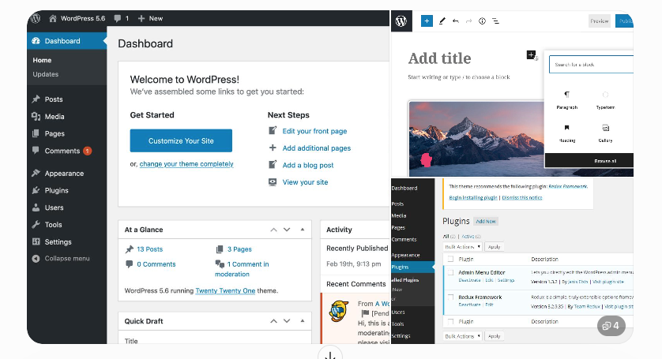

# Wordpress instalación

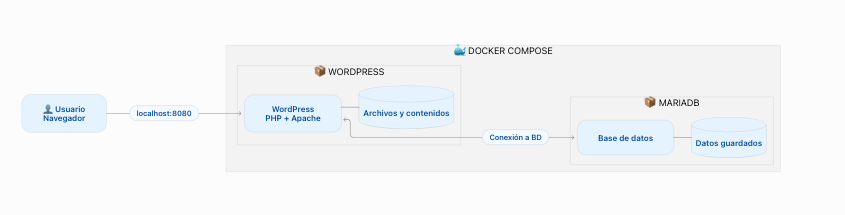

```bash
docker compose up -d
```

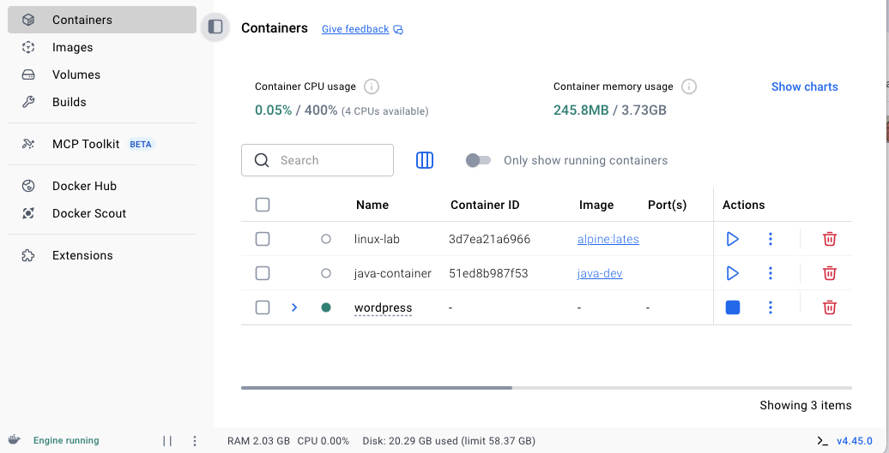

http://localhost:8080

Ahora, completar las configuraciones (contraseña, titulo, ...)

Posteriormente, se puede acceder y modificar en SETTINGS:

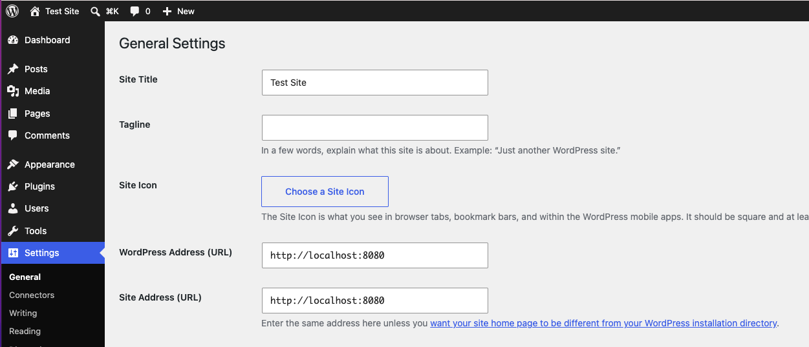

# Maria DB

Para acceder solamente al contenedor de Maria DB, la base de datos:

```bash
docker exec -it <db-container-name> sh
```


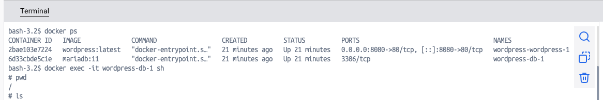

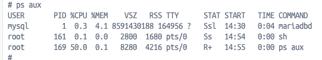

Recordar que la contraseña para MariaDB del root usuario esta en el docker compose: 

```yaml
environment:
      MYSQL_ROOT_PASSWORD: rootpassword
```

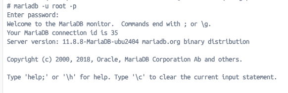

Ahora, podemos cambiar la base de datos a la usada por wordpress y ver las tablas:

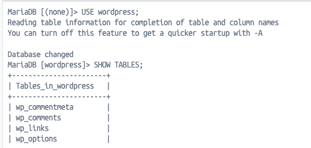

y ejecutar comandos de SQL como

```sql
SELECT ID, user_login, user_email
FROM wp_users;
```

Y al introducir u nuevo usuario en la interfaz, deberia aparecer en la base de datos de tabla wp_users:

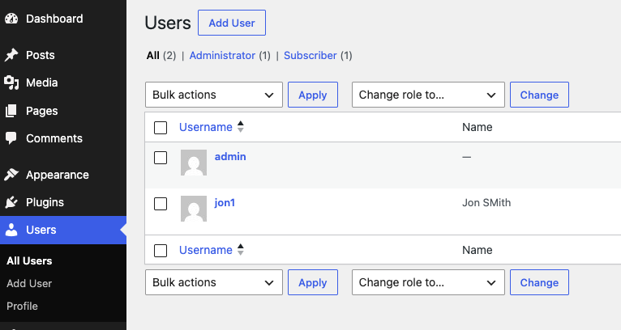

Para salir de Maria DB:

```sql
exit;
```

Para cerrar todo:
```bash
docker compose down
```

**Cuidado** - Borrar tmabien los datos de los volumenes (MariaDB)
```bash
docker compose down -v
```

# Actividades
## Actividad 1

Ejecutamos unos comandos en general, sobre la base de datos. ¿Sabeis que hace cada uno de los comandos?
```sql
SHOW DATABASES;

USE wordpress;

SHOW TABLES;

DESCRIBE wp_users;

DESCRIBE wp_posts;

STATUS;
SHOW PROCESSLIST;

```

## Actividad 2
Echar un vistazo a este comando y a ver si puedes encontrar / relacionar la informacion en el UI de Wordpress.

```sql
SELECT ID, post_title, post_status FROM wp_posts;

SELECT ID, user_login, user_email
FROM wp_users
WHERE user_login = 'admin';

SELECT ID, post_title, post_date
FROM wp_posts
WHERE post_status = 'publish';


SELECT ID, post_title
FROM wp_posts
WHERE post_title LIKE '%WordPress%';   // buscar por titulo del post si contiene

SELECT COUNT(*) AS total_users
FROM wp_users;

SELECT option_name, LENGTH(option_value) AS size_bytes
FROM wp_options
WHERE option_name = 'cron';

```

Si añades nuevas páginas, posts o usuarios en la UI, ¿aparecen en la base de datos?

## Actividad 2

¿Cual es la diferencia entre los dos comandos, y qué muestran?

```sql
SELECT option_name, option_value FROM wp_options LIMIT 10;
SELECT option_name, option_value FROM wp_options LIMIT 10\G;
```

Encuentra la información en la UI


## Actividad 3

Salir de Maria DB contenedor, y ejecutar este comando. 
```
docker stop wordpress-db-1
```

Ahora, acceder a localhost:8080

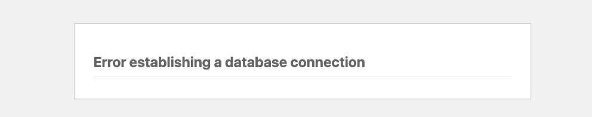

¿Ahora qué vas a hacer?

## Acceder a PHP

https://marcocastro.wordpress.com/2009/12/18/la-historia-del-php/

PHP nació en 1994, creado por **Rasmus Lerdorf**. Inicialmente no era un lenguaje de programación completo, sino un conjunto de herramientas escritas en C para gestionar su página web personal.

De ahí viene su nombre original: Personal Home Page Tools.

Su principal objetivo era sencillo: permitir que una página HTML pudiera incorporar código que se ejecutase en el servidor.

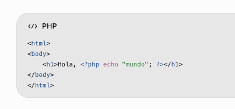

El servidor ejecuta PHP y envía al navegador el HTML resultante. El navegador nunca recibe el código PHP original.

Durante los años 90, PHP empezó a utilizarse muchísimo junto con MySQL.

La combinación era especialmente interesante:
- Linux: sistema operativo del servidor.
- Apache: servidor web que recibía las peticiones HTTP.
- MySQL: base de datos para almacenar información.
- PHP: lenguaje que generaba las páginas dinámicamente.

Esta combinación se conoció como **LAMP** (Linux, Apache, MySQL, PHP).

---

Vamos a usar el comando ´docker compose exec´ para acceder al contenedor de wordpress, para investigar las aplicaciones como apache y php.


```bash
docker compose exec wordpress bash     # usar el nombre del servicio del docker-compose
```

Una vez dentro del contenedor, podemos explorar el servidor:

```bash
php -v
apache2 -v
ls -la /var/www/html
php -r 'echo "Hello from PHP!\n";'

php -r "phpinfo();"

echo '<?php phpinfo(); ?>' > info.php
echo '<?php phpinfo(); ?>' > /var/www/html/info.php


php -r "phpinfo();" # Correcto
php -r "<?php phpinfo(); ?>" # Incorrecto
```

## phpMyAdmin

**phpMyAdmin** es una herramienta gratuita y de código abierto, escrita en PHP, que permite administrar bases de datos MySQL y MariaDB a través de una interfaz gráfica en el navegador web

Vamos a instalar phpMyAdmin al docker compose, para poder gestionar de forma visual la base de datos.

Añadimos un nuevo servicio al docker-compose, después del servicio de base de datos:

```yml
  phpmyadmin:
    image: phpmyadmin:latest
    restart: unless-stopped
    ports:
      - "8081:80"
    environment:
      PMA_HOST: db
      PMA_USER: root
      PMA_PASSWORD: rootpassword
    depends_on:
      - db
```

Acceder a phpMyAdmin a través del http://localhost:8081

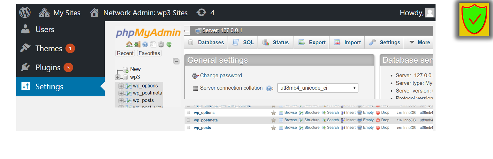


# Respuestas
Actividad 3
docker ps -a
docker logs wordpress-db-1
docker start wordpress-db-1

OR
docker compose up -d db
docker compose up -d