# Configuración de un clúster Apache Spark con Docker

Vamos a crear un pequeño entorno de Big Data utilizando Docker Compose. El entorno tendrá 3 contenedores:
1. Spark Master: coordina el clúster y gestiona los recursos disponibles.
2. Spark Worker: proporciona los recursos de procesamiento (CPU y memoria) para ejecutar las tareas.
3. Jupyter Notebook: permite escribir y ejecutar código Python utilizando PySpark.

Los 3 contenedores estarán conectados mediante una red Docker para poder comunicarse entre sí.

## Estructura de carpetas

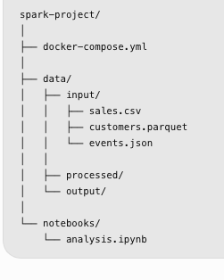

## Proceso diario de ingesta de datos
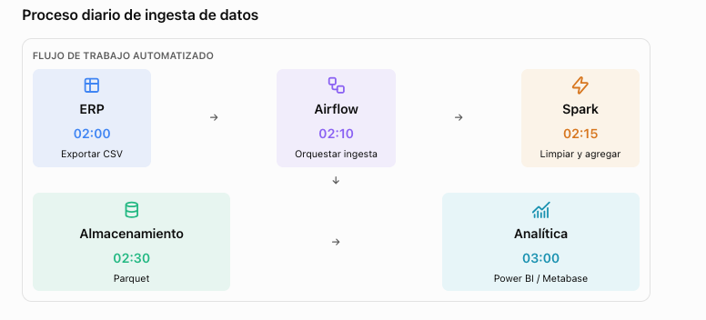

## Configuracion y pasos

```bash
docker compose up -d
```

A. Spark Master
Es el coordinador del clúster. Se encarga de registrar los workers y gestionar los recursos disponibles.

B. Spark Worker
Es el encargado de proporcionar los recursos de procesamiento al clúster.

C. Jupyter Notebook
Proporciona un entorno interactivo donde podemos escribir y ejecutar código Python.
Volumenes: Conecta una carpeta de nuestro ordenador con otra del contenedor.

D. Red Docker
Creamos una red de tipo bridge para permitir la comunicación entre los contenedores.
Los servicios pueden utilizar sus nombres como direcciones de red. Por ejemplo:
´spark://spark-master:7077´
Esto permite que Jupyter y el Worker encuentren al Master sin tener que conocer su dirección IP.

Una ´red´ Docker permite que varios contenedores se comuniquen entre ellos. De esta forma, los tres contenedores pueden comunicarse utilizando sus nombres de servicio como nombres de host, en lugar de IPs.

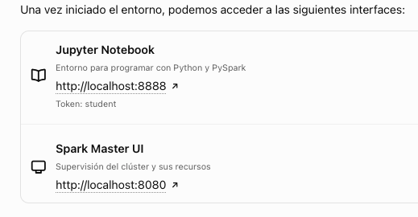


**Jupyter: localhost:8888 (token: student)**
- Es donde  escriben y ejecutan el código Python y PySpark.

**Spark Master: localhost:8080**
Es el panel de administración del clúster Spark. Permite observar cómo está organizado y qué recursos tiene disponibles.
- Consultar el estado del Spark Master.
- Ver los Workers conectados.
- Consultar los recursos disponibles (CPU y memoria).
- Ver las aplicaciones Spark que se están ejecutando.

Por ejemplo, permite comprobar si nuestro spark-worker está conectado correctamente al Master.

**Spark Application UI – http://localhost:4040**
Es el panel de monitorización de una aplicación Spark concreta que se está ejecutando desde Jupyter.
- Consultar los Jobs que se han ejecutado.
- Ver las Stages y Tasks en las que se divide el trabajo.
- Consultar los Executors utilizados.
- Analizar el tiempo de ejecución y el uso de recursos.

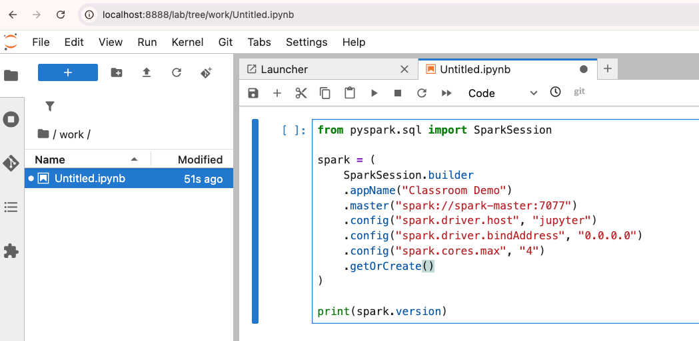

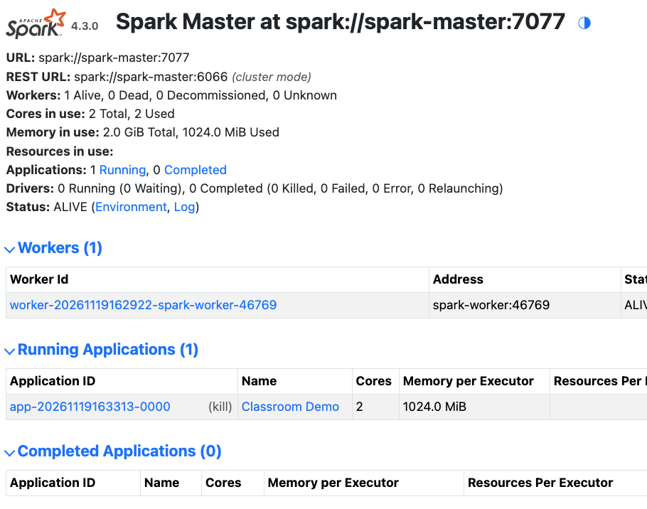

# Ejemplos de programacion con data frames

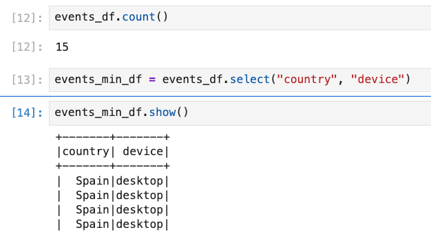

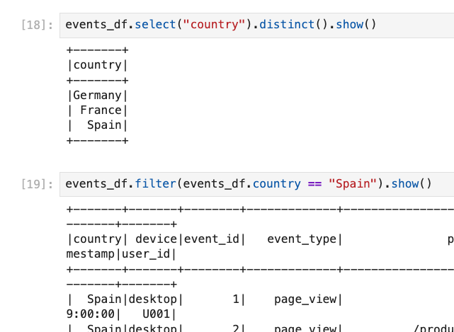

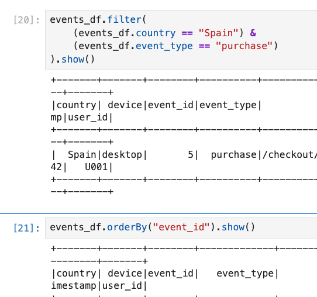

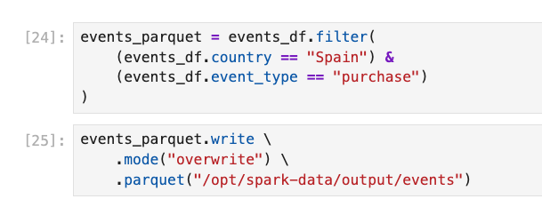

Ahora vamos a aprender a usar SQL con PySpark

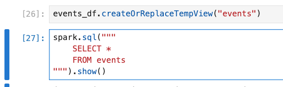

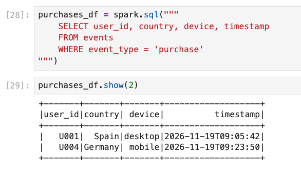

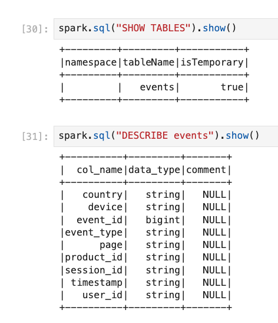

En Apache Spark, el sistema de catálogos (Catalogs) es el mecanismo que permite organizar, registrar y localizar los datos para poder consultarlos mediante SQL.

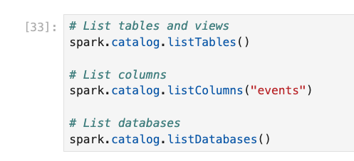

Una tabla permanente se registra en el catálogo de Spark y permite reutilizarla en diferentes sesiones.

A diferencia de la vista temporal, Spark almacena los datos en un formato físico (por ejemplo, Parquet) y registra sus metadatos en el catálogo.

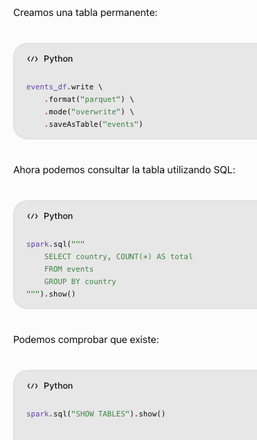

## Comandos 
### Stop everything
docker compose down

### View logs
docker compose logs -f

### Restart a worker
docker compose restart spark-worker-1

### Remove containers
docker compose down


## Actividades
Descargar unos datos en formato parquet para usar:

https://viewparquet.com/blog/free-public-parquet-datasets


https://s3.amazonaws.com/assets.datacamp.com/blog_assets/PySpark_SQL_Cheat_Sheet_Python.pdf


