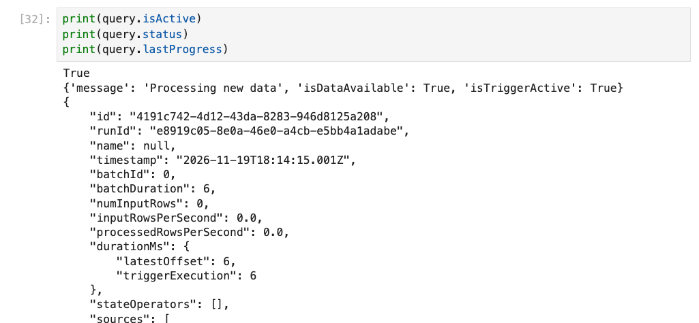
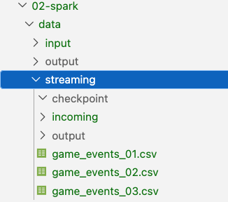
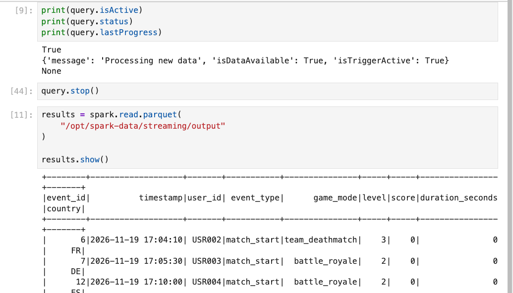

# Antes de empezar, estructura de datos

Vamos a ir pasando los datos a la carpeta de /incoming, poco a poco, y viendo al final los datos en la carpeta de /output



OJO: Confirmar que tenemos un archivo existente en la carpeta /incoming, nada mas empezar

# celda 1

```python
from pyspark.sql import SparkSession
from pyspark.sql.types import *
from pyspark.sql.functions import *

spark = (
    SparkSession.builder
    .appName("VideoGameStreaming")
    .master("spark://spark-master:7077")
    .getOrCreate()
)

spark.sparkContext.setLogLevel("WARN") # solo mostrar mensajes de avisos
```

## Antes de empezar, comprobamos que Spark puede leer un archivo de datos csv en la carpeta /incoming

```python
test_df = (
    spark.read
    .option("header", True)
    .schema(game_schema)
    .csv("/opt/spark-data/streaming/incoming")
)

test_df.show(truncate=False)
print("Rows:", test_df.count())
```

# celda 2
## Para streaming, hay que definir un esquema

```python
game_schema = StructType([
    StructField("event_id", IntegerType()),
    StructField("timestamp", TimestampType()),
    StructField("user_id", StringType()),
    StructField("event_type", StringType()),
    StructField("game_mode", StringType()),
    StructField("level", IntegerType()),
    StructField("score", IntegerType()),
    StructField("duration_seconds", IntegerType()),
    StructField("country", StringType())
])
```

# celda 3
```python
games_stream = (
    spark.readStream
    .option("header", True)
    .schema(game_schema)
    .csv("/opt/spark-data/streaming/incoming")
)
```

# celda 4
```python
print(games_stream.isStreaming)
```

# celda 5
## definimos añgun tipo de filtro o query con los datos
```python
match_starts = games_stream.filter(
    col("event_type") == "match_start"
)
```

# celda 6
```python
query = (
    match_starts.writeStream
    .format("parquet")
    .outputMode("append")
    .option(
        "path",
        "/opt/spark-data/streaming/output"
    )
    .option(
        "checkpointLocation",
        "/opt/spark-data/streaming/checkpoint"
    )
    .trigger(processingTime="5 seconds")
    .start()
)
```

# celda 7
```python
print(query.isActive)
print(query.status)
print(query.lastProgress)
```


# celda 8 - Resultado final
```python
results = spark.read.parquet(
    "/opt/spark-data/streaming/output"
)

results.show()
```

# celda 9
```python
query.stop()
```

# Ayuda
Si hay problemas, ejecutar estos comandos para comprobar:

```python
import os

input_path = "/opt/spark-data/streaming/incoming"

print(os.listdir(input_path))
```

```
with open("/opt/spark-data/streaming/incoming/game_events_01.csv", "r") as f:
    print(f.read())
```


