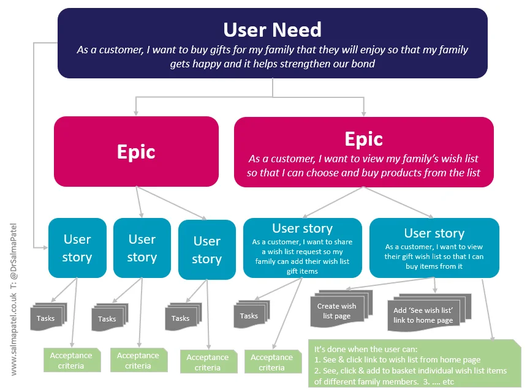
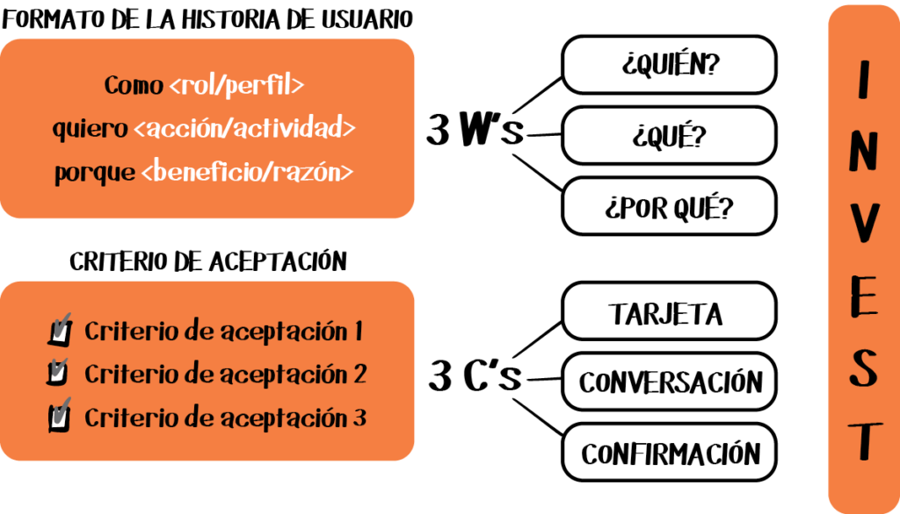
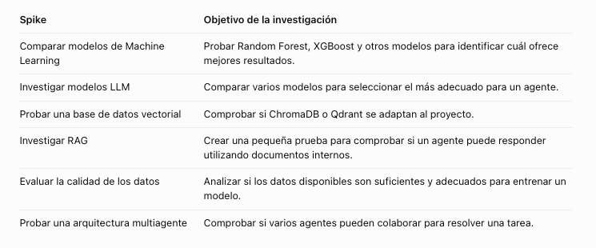
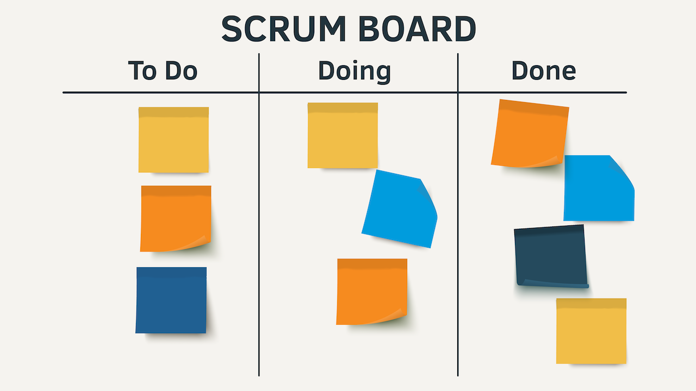
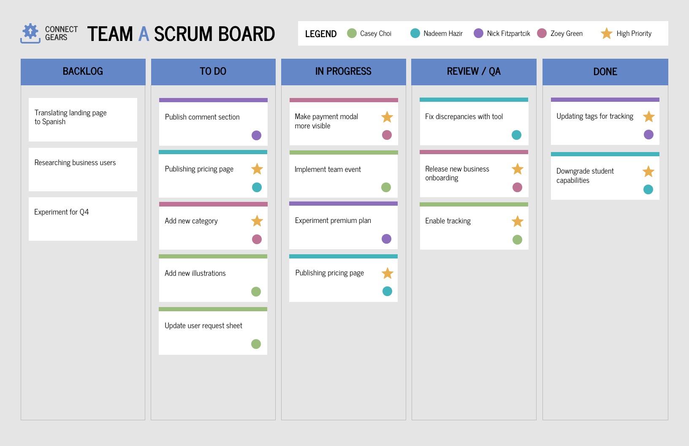
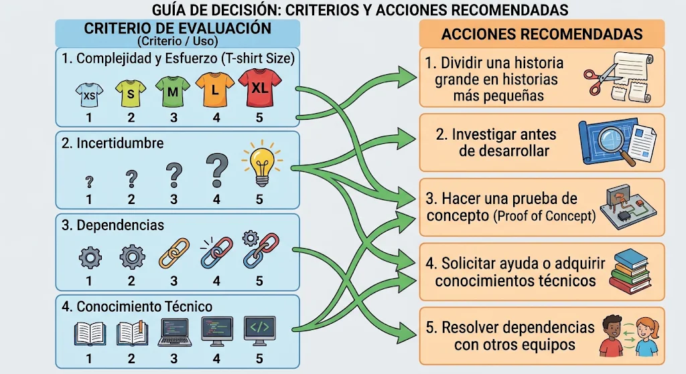
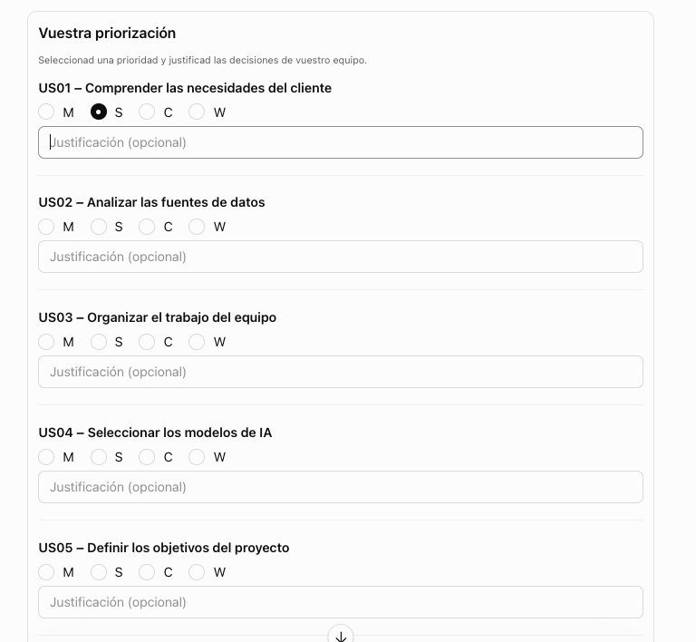

# Gestion de proyectos ágiles



## Historias de Usuarios



El formato de historias de usuario (User Stories) aporta varias ventajas al desarrollo de proyectos:
1. Centrarse en el usuario: ayuda a entender quién necesita algo y para qué lo necesita.
2. Entender el valor de cada funcionalidad: explica qué beneficio aporta al usuario o al negocio.
3. Facilitar la comunicación: permite que clientes, desarrolladores y otros perfiles hablen sobre las mismas necesidades.
4. Evitar centrarse demasiado pronto en la solución técnica: describe qué se necesita, no cómo debe programarse.
5. Facilitar la priorización: permite decidir qué funcionalidades son más importantes mediante MoSCoW, por ejemplo.
6. Dividir el trabajo: ayuda a transformar necesidades grandes en historias más pequeñas y manejables.
7. Facilitar la estimación: permite valorar el esfuerzo y la complejidad con técnicas como T-Shirt Sizing.
8. Mejorar la planificación: facilita organizar el trabajo en un Product Backlog y un tablero Kanban.
9. Facilitar la validación: permite definir criterios de aceptación para comprobar si la funcionalidad cumple lo esperado.
10. Adaptarse a los cambios: las historias pueden modificarse según se aprende más sobre el proyecto y las necesidades del cliente.


Un **Spike** es una actividad de investigación o experimentación que realiza el equipo antes de desarrollar una funcionalidad, cuando todavía hay demasiadas dudas o incertidumbre.

Su objetivo no es crear una funcionalidad terminada, sino aprender lo suficiente para poder tomar una decisión técnica y planificar mejor el trabajo.



### Actividad

Escribir 3 historias de usuarios para los siguientes requisitos:

**Requisitos 1:**
Cliente: responsable de operaciones de una cadena de supermercados

La empresa tiene 15 establecimientos y cada día registra miles de ventas. El responsable de operaciones tiene dificultades para anticipar cuántas unidades de cada producto necesitará cada tienda.

Actualmente, los pedidos se realizan principalmente teniendo en cuenta las ventas de semanas anteriores y la experiencia de los empleados. Esto provoca que algunos productos se agoten rápidamente, mientras que otros terminan acumulándose en el almacén y caducando.

El responsable quiere aprovechar los datos históricos de ventas, las tendencias de consumo y la estacionalidad para anticipar la demanda y planificar mejor los pedidos.

**Requisitos 2:**
Cliente: directora de marketing de una tienda online

La empresa recibe cientos de opiniones y comentarios diarios de sus clientes sobre los productos que vende. El equipo de marketing intenta leerlos y clasificarlos manualmente para conocer qué productos gustan más y cuáles generan insatisfacción.

Sin embargo, el volumen de comentarios es cada vez mayor y resulta imposible analizarlos todos. Además, muchas opiniones utilizan expresiones informales, ironía o describen varios problemas en un mismo comentario.

La directora quiere utilizar Inteligencia Artificial para analizar automáticamente las opiniones, identificar si son positivas o negativas y detectar los aspectos de los productos que generan más satisfacción o reclamaciones.

**Requisitos 3:**
Cliente: responsable del departamento de prevención del fraude de un banco

El banco procesa miles de operaciones financieras cada minuto. Aunque dispone de sistemas de seguridad, cada vez resulta más complicado detectar determinadas operaciones fraudulentas.

Algunos delincuentes realizan pequeñas transacciones desde diferentes cuentas, en horarios poco habituales o hacia destinos que nunca habían utilizado anteriormente. Estas operaciones pueden parecer normales cuando se analizan individualmente, pero muestran patrones sospechosos cuando se estudian conjuntamente.

El responsable quiere disponer de un sistema inteligente que analice las transacciones en tiempo real, detecte comportamientos anómalos y genere alertas para que los especialistas puedan investigar las operaciones sospechosas.


--

## Kanban / Scrum Boards






## Backlog refinement
El backlog refinement es la actividad en la que el equipo revisa y mejora el product backlog.

Se analizan las historias de usuario, se detallan requisitos, se corrigen ambigüedades, se estiman tamaños y se priorizan.

El objetivo es que las historias estén claras y listas para ser trabajadas en futuros sprints.


### Quiénes participan

- Product Owner (PO): guía las prioridades y clarifica los requisitos.

- Scrum Master: facilita la sesión y asegura que se cumpla el proceso.

- Equipo de desarrollo: aporta estimaciones, identifica dependencias y riesgos.

- A veces también participan stakeholders para aclarar dudas sobre necesidades del negocio.

### Frecuencia

Frecuencia recomendada: cada 1 o 2 semanas, para mantener el backlog actualizado y listo para los sprints.


## Tecnicas

**MoSCoW**: ¿Qué es más importante y qué debemos hacer primero?
**T-Shirt Sizing**: ¿Cuánto esfuerzo o complejidad supone realizar cada tarea?

### MoSCoW

El objetivo de MoSCoW es priorizar los requisitos y funcionalidades de un proyecto según su importancia y necesidad, para decidir qué debe desarrollarse primero, qué puede esperar y qué queda fuera del alcance del proyecto.

No se trata simplemente de ordenar tareas, sino de gestionar las prioridades y las expectativas, teniendo en cuenta el tiempo y los recursos disponibles.

Clasifica cada historia en cuatro categorías:

- M: Must have (Debe tener) → imprescindible

- S: Should have (Debería tener) → importante pero no crítica

- C: Could have (Podría tener) → opcional, nice-to-have

- W: Won’t have (No tendrá) → se pospone

### T-Shirt Sizing




T-Shirt Sizing es una técnica de estimación ágil que permite calcular el tamaño relativo de las tareas o User Stories de un proyecto utilizando tallas de camiseta: XS, S, M, L y XL.

Su objetivo es que el equipo pueda estimar cuánto esfuerzo y complejidad supone desarrollar cada funcionalidad, sin necesidad de calcular exactamente las horas o días que llevará realizarla.

Pueden proponer dividir una User Story grande en historias más pequeñas (story splitting).

T-Shirt Sizing debería servir también para identificar cuándo necesitamos:
- Dividir una historia grande en historias más pequeñas.
- Investigar antes de desarrollar.
- Hacer una prueba de concepto (Proof of Concept).
- Solicitar ayuda o adquirir conocimientos técnicos.
- Resolver dependencias con otros equipos.


### Actividad

- Usando la técnica de 't-shirt sizing', estimar la complejidad la complejidad usando t-shirts (S, M, L, XL). “relativo” = depende de la comparación con otras tareas, no de un valor absoluto fijo. Por ejemplo, 'S' comparando con 'L' es más complejo, pero no quiere decir 2 horas (absoluto). 
- Usar Moscow para priorizar

Generar una interactividad con la IA para poder organizar mejor las tareas con T-shirts o Moscow. La solucion deberia ser como este ejemplo:



Como ingeniero de IA, quiero reunirme con los stakeholders para conocer sus problemas, necesidades y expectativas, para asegurarme de que la solución tecnológica responde a un problema real del negocio.

Como ingeniero de datos, quiero identificar y analizar las fuentes de datos disponibles en la empresa, para conocer su estructura, calidad, volumen y utilidad para el proyecto.

Como Scrum Master o responsable del equipo, quiero organizar las tareas en un tablero Kanban y establecer responsabilidades, para facilitar el seguimiento del proyecto y conocer el estado de cada actividad.

Como ingeniero de Machine Learning, quiero investigar y comparar diferentes modelos de IA disponibles, para seleccionar el que mejor se adapte a los requisitos técnicos y funcionales del proyecto.

Como responsable del proyecto, quiero acordar con el cliente los objetivos y los indicadores de éxito (KPIs), para poder evaluar si la solución desarrollada aporta valor al negocio.

Como ingeniero de IA, quiero diseñar una arquitectura donde varios agentes inteligentes puedan colaborar, intercambiar información y utilizar herramientas externas, para resolver tareas complejas de forma coordinada.

Como ingeniero de datos, quiero limpiar, transformar y normalizar los datos disponibles, para garantizar que puedan utilizarse correctamente en los modelos de Inteligencia Artificial.

Como responsable del proyecto, quiero establecer reuniones periódicas con los stakeholders y compartir informes de progreso, para mantenerlos informados y recoger sus comentarios durante el desarrollo.

Como ingeniero de IA, quiero desarrollar un primer prototipo utilizando un modelo existente y un conjunto reducido de datos, para validar la viabilidad técnica de la solución antes de desarrollar el sistema completo.

Como responsable de seguridad del proyecto, quiero identificar los riesgos relacionados con la privacidad, los permisos de acceso y el uso de datos personales, para garantizar que la solución cumple los requisitos legales y de seguridad.

Como ingeniero de IA, quiero investigar nuevos frameworks de agentes, modelos LLM y bases de datos vectoriales, para identificar posibles mejoras tecnológicas que podamos incorporar al proyecto.

Como responsable del proyecto, quiero preparar una presentación ejecutiva con los objetivos, la arquitectura propuesta, los costes y los beneficios esperados, para conseguir la aprobación de la dirección.


### Diversion con la programación en Javascript

```javascript
const historias = [
  "Como usuario, quiero poder filtrar productos por categoría, para encontrar más rápido lo que busco.",
  "Como usuario, quiero recibir notificaciones cuando haya ofertas especiales, para no perderme descuentos.",
  "Como usuario, quiero registrarme en la app usando mi correo electrónico y contraseña, para poder acceder a todas las funciones.",
  "Como usuario, quiero iniciar sesión con mi cuenta de Google, para no tener que recordar otra contraseña.",
  "Como usuario, quiero recibir mensajes de ayuda dentro de la app con un chatbot, para resolver dudas rápidamente."
];
```

Crear una función para:
- mostrar la lista de historias de usuarios al revés
- aleatoriamente - vaya reto!

Usar el algoritmo de Fisher y Yates:

https://www.youtube.com/watch?v=_rUa0cp6a1c


Cómo hacer un shuffle con Fisher-Yates, paso a paso:

1. Empezar desde el final del array

Comenzamos con el último elemento de la lista.

La idea es decidir aleatoriamente con quién se va a intercambiar.

2. Seleccionar un índice aleatorio

Para el elemento actual, elegimos un índice aleatorio entre 0 y la posición actual inclusive.

Este índice será el lugar con el que vamos a intercambiar el elemento.

```javascript
r = Math.floor(Math.random() * (i + 1)); // 0 ≤ r ≤ i
```

3. Intercambiar los elementos

Tomamos el elemento actual y lo intercambiamos con el elemento en el índice aleatorio seleccionado.

Esto garantiza que el elemento actual puede quedarse en su lugar o moverse a cualquier otra posición anterior.

4. Retroceder al elemento anterior

Bajamos una posición en la lista (hacia el principio) y repetimos el proceso:

Elegir un índice aleatorio entre 0 y la posición actual.

Intercambiar los elementos.

5. Repetir hasta el principio

Continuamos hasta llegar al primer elemento de la lista.

Al final, todos los elementos estarán mezclados aleatoriamente.


## Respuestas

Caso 1. Predicción de demanda

Como responsable de operaciones, quiero consultar predicciones de ventas por producto y establecimiento para los próximos días, basadas en el historial de ventas y los patrones de consumo, para optimizar los pedidos y reducir las roturas de stock y los excedentes de inventario.

Tecnología: Big Data, ETL, series temporales y Machine Learning.

Caso 2. Análisis de sentimientos

Como directora de marketing, quiero que el sistema analice automáticamente las opiniones de los clientes, clasificándolas por sentimiento e identificando los principales aspectos positivos y negativos de cada producto, para conocer la satisfacción de los clientes y detectar oportunidades de mejora.

Tecnología: NLP, análisis de sentimientos e IA generativa.

Caso 3. Detección de fraude

Como responsable de prevención del fraude, quiero recibir alertas cuando el sistema detecte patrones de transacciones anómalos en tiempo real, para investigar posibles operaciones fraudulentas antes de que generen pérdidas económicas.